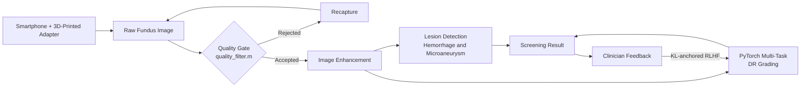

<div align="center">

# NetraSense

### Adaptive Retinal Screening AI & 3D-Printed Hardware

*An end-to-end, low-cost diabetic retinopathy (DR) screening pipeline, from a 3D-printed phone adapter to clinician-in-the-loop AI.*

[Video Demo](https://drive.google.com/file/d/14a7HKVSnaQPbePSgQ4wUk6hhX6Ago4Qr/view?usp=sharing) •
[Demo Images](https://drive.google.com/drive/folders/1maapR4iSoNl-SaP4cdFXWEq9AVurF7XF?usp=sharing)

</div>

---

## Table of Contents
- [Overview](#-overview)
- [Key Features](#-key-features)
- [Pipeline Architecture](#-pipeline-architecture)
- [Repository Structure](#-repository-structure)
- [Demo & Presentation](#-demo--presentation)

---

## Overview

NetraSense bridges the gap between resource-constrained clinics and specialist-level ophthalmology.

Traditional screening tools tend to fail in one of three ways:

| Problem | Impact |
|---|---|
| Prohibitively expensive equipment | Rural and small clinics can't afford it |
| High scan rejection from poor lighting or blur | Repeat visits and missed screenings |
| Rigid, black-box classifiers | Can't adapt to local clinical feedback |

**NetraSense solves all three** with one modular ecosystem, from the lens to the model.

---

## Key Features

| # | Module | Description |
|---|---|---|
| 1 | **Low-Cost Hardware** | 3D-printed, smartphone-compatible fundus camera adapter|
| 2 | **Pre-Diagnostic Quality Gate** | MATLAB optical feature extraction validates clarity *before* grading |
| 3 | **Multi-Task Lesion Detection** | MATLAB enhancement and lesion localization for hemorrhages and microaneurysms |
| 4 | **Adaptive ML + RLHF** | PyTorch multi-task DR grading with **KL-anchored clinician RLHF** |

---

## Pipeline Architecture



---

### Hardware Prototyping (`.stl`)
Designed and modeled a portable, 3D-printed smartphone fundus camera attachment to cut equipment barriers.

### MATLAB Optical Pipeline (`.m` / `.txt`)

| Script | Purpose |
|---|---|
| Quality Filter| Evaluates **illumination, blur, and contrast** to accept or reject scans |
| Image Enhancement | Enhances retinal vascular visibility |
| Hemorrhage Detection | Rule-based and morphological extraction of hemorrhage regions |
| Microaneurysms Detection | Morphological detection of microaneurysms |

### Machine Learning & RLHF (`.ipynb`)
- PyTorch training pipelines for **multi-task DR grading**
- **KL-divergence anchored RLHF** that updates model weights from clinician corrections while **avoiding catastrophic forgetting**

---

## Repository Structure

```text
├── NetraSense_Presentation.pdf
├── README.md                            # Project documentation
```

---
## Demo & Presentation

| Resource | Link |
|---|---|
| Video Demo Walkthrough | [Google Drive](https://drive.google.com/file/d/14a7HKVSnaQPbePSgQ4wUk6hhX6Ago4Qr/view?usp=sharing) |
| Sample Fundus & Result Images | [Google Drive Folder](https://drive.google.com/drive/folders/1maapR4iSoNl-SaP4cdFXWEq9AVurF7XF?usp=sharing) |

---

<div align="center">

*Making retinal screening accessible, one scan at a time.* 

</div>
